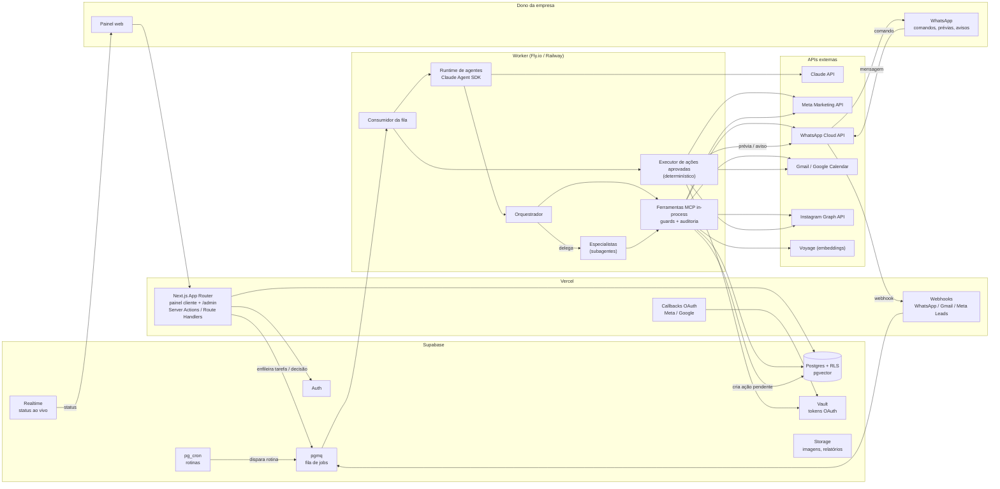
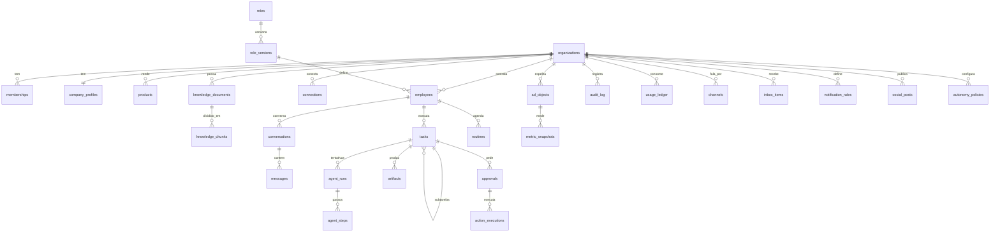
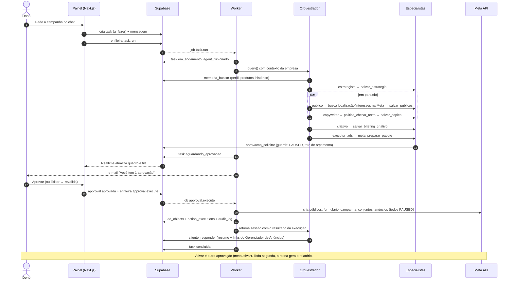
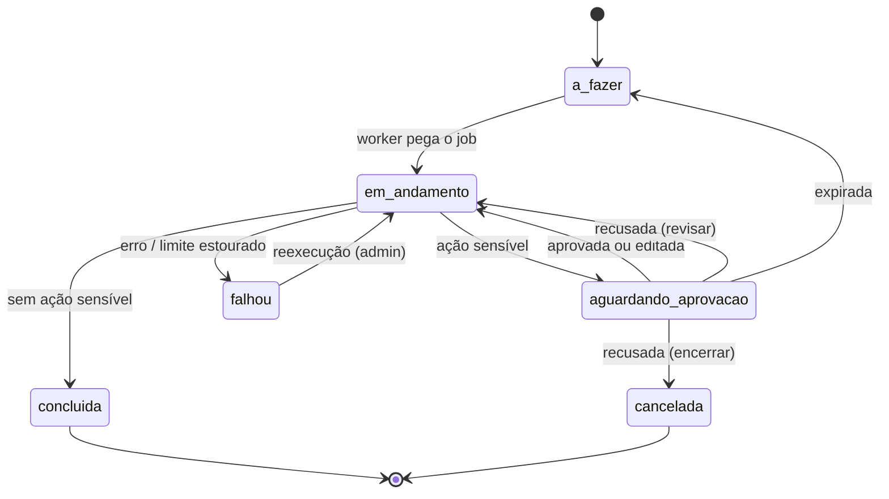
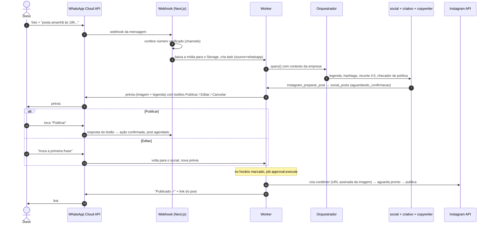

# PLANO — Givance Workforce (nome provisório)

> Plataforma que vende **"funcionários de IA"** para PMEs brasileiras. Cada funcionário é um time de agentes coordenado por um orquestrador, que executa tarefas reais e presta contas como um colaborador humano.
>
> **Status:** proposta para aprovação, **revisão 2**. Nenhum código foi escrito ainda. A seção [0. Decisões que preciso de você](#0-decisões-que-preciso-de-você) lista o que precisa ser fechado antes da Fase 1.
>
> **O que mudou na revisão 2:** além do tráfego pago, o sistema agora cobre **e-mail** (triagem e resposta), **agenda** (marcar reuniões), **avisos do que é importante no WhatsApp** e **posts no Instagram por comando**. O WhatsApp virou o canal principal de comando. Novos agentes: `social`, `triagem` e `secretaria`. Entram níveis de autonomia por tipo de ação (8.2) e um cargo combinado, o **Braço Direito**. O roadmap foi reordenado: você é o primeiro usuário.

---

## Sumário

0. [Decisões que preciso de você](#0-decisões-que-preciso-de-você)
1. [Princípios de arquitetura](#1-princípios-de-arquitetura)
2. [Arquitetura](#2-arquitetura)
3. [Estrutura do repositório](#3-estrutura-do-repositório)
4. [Modelo de dados](#4-modelo-de-dados)
5. [Agentes e ferramentas](#5-agentes-e-ferramentas)
6. [Cargos como configuração](#6-cargos-como-configuração)
7. [Fluxo de uma tarefa, de ponta a ponta](#7-fluxo-de-uma-tarefa-de-ponta-a-ponta)
8. [Aprovações, segurança e conformidade](#8-aprovações-segurança-e-conformidade)
9. [Rotinas agendadas](#9-rotinas-agendadas)
10. [Custos, uso e observabilidade](#10-custos-uso-e-observabilidade)
11. [Painéis](#11-painéis)
12. [Roadmap em fases](#12-roadmap-em-fases)
13. [Riscos e como mitigar](#13-riscos-e-como-mitigar)
14. [Checklist preliminar do que você vai configurar](#14-checklist-preliminar-do-que-você-vai-configurar)

---

## 0. Decisões que preciso de você

Para cada item deixei uma recomendação. Se você concordar com todas, basta responder "aprovado".

| # | Decisão | Recomendação | Por quê |
|---|---------|--------------|---------|
| D1 | **Onde rodam os agentes** | Um serviço **worker** Node separado (Fly.io ou Railway), não dentro da Vercel | O Claude Agent SDK roda o harness do Claude Code como processo de longa duração; tarefas de agente duram minutos e não cabem bem em funções serverless. A Vercel fica só com o Next.js. |
| D2 | **Modelos por agente** | Começar com `claude-opus-5-5` em todos, com o modelo configurável por agente no YAML do cargo | Qualidade primeiro no MVP. Depois medimos custo por tarefa e você decide se troca especialistas simples (ex.: `analista` lendo métricas) por Sonnet 5.5 ou Haiku 5.5 para melhorar margem. A triagem de e-mail roda o dia inteiro e é a principal candidata a um modelo mais barato. |
| D3 | **Embeddings para o RAG** | Voyage AI (`voyage-3.5`, 1024 dimensões) | A Anthropic não oferece endpoint de embeddings; a Voyage é a parceira recomendada e tem bom desempenho em português. Alternativa: OpenAI `text-embedding-3-small`. |
| D4 | **De onde vêm as imagens dos posts e anúncios** | Fase 1: a imagem ou o vídeo que você manda no WhatsApp ou no painel, ou o banco de mídia da empresa. O `criativo` escolhe, recorta nos formatos e escreve o texto. Depois: geração por modelo de imagem ou templates do Canva como provedor plugável | Claude não gera imagens, e o Instagram exige mídia pronta. Assim o comando "posta isso" funciona já, sem escolher provedor agora. |
| D5 | **WhatsApp como canal principal** | Entra já na Fase 1: um número da Givance na WhatsApp Cloud API recebe seus comandos, manda prévias com botões (Publicar / Editar / Cancelar) e encaminha o que for importante | É por onde você quer mandar comandos e receber avisos. Mensagens iniciadas pelo sistema fora da janela de 24h exigem template aprovado pela Meta (categoria utilidade) e são cobradas por mensagem. |
| D6 | **Modelo de app na Meta** | Um único app da Givance (Tech Provider / parceiro), com App Review para as permissões de anúncios, Instagram e WhatsApp; cada cliente conecta via OAuth (Facebook Login for Business) | Cliente não precisa criar app próprio. Custo: App Review e verificação da empresa Givance levam semanas, então começam já na Fase 1. |
| D7 | **Gestor de pacotes / monorepo** | pnpm + Turborepo | Padrão para Next.js + worker + pacotes compartilhados. |
| D8 | **Para quem é a primeira versão** | Você (Givance) é o primeiro usuário: tudo roda primeiro na sua conta, com a mesma arquitetura multi-tenant | Você usa no dia a dia antes de vender. Para uso próprio, os apps do Google e da Meta funcionam em modo de teste/desenvolvimento, sem esperar revisões. As revisões só são necessárias para vender a outras empresas. |
| D9 | **Provedor de e-mail e agenda** | Gmail + Google Calendar primeiro; Outlook (Microsoft 365) depois, se algum cliente pedir | Se o seu e-mail for Outlook, me avise e eu inverto. |
| D10 | **Ordem das fases** | Fase 1: fundação + WhatsApp + Instagram + e-mail/agenda. Fase 2: tráfego pago | É o que você usa todo dia. O tráfego usa o mesmo app da Meta e vem logo em seguida. Se preferir o tráfego primeiro (é o que vende), eu inverto. |
| D11 | **Autonomia por tipo de ação** | Configurável em três níveis (ver 8.2). Padrão: post no Instagram com **confirmação de um toque** no WhatsApp; e-mail para terceiros com confirmação; evento só na sua agenda é automático; gasto de dinheiro sempre com aprovação no painel | Você pediu "dou o comando e ele posta". Como o comando vem de você, a aprovação vira um toque na prévia, não uma fila. Dá para colocar o post em automático, mas não recomendo no começo. |

---

## 1. Princípios de arquitetura

1. **Segurança é código, não prompt.** O prompt pede para o agente criar campanhas pausadas; quem *garante* isso é a ferramenta `meta_criar_campanha`, que força `status=PAUSED` e rejeita orçamento acima do limite da empresa, independentemente do que o modelo enviar.
2. **Agente propõe, sistema executa.** Ações sensíveis nunca são executadas pelo agente diretamente. A ferramenta grava uma **ação pendente** (payload validado por schema) e devolve "aguardando aprovação". Depois da aprovação, o **sistema** executa aquele payload exato, de forma determinística e idempotente, sem chamar o modelo de novo. "Editar" no card altera o payload, que é revalidado antes de executar.
3. **Agentes nunca veem credenciais.** Tokens OAuth ficam no Supabase Vault; as ferramentas resolvem a credencial do lado do servidor a partir do `org_id` da tarefa.
4. **Toda saída de especialista é estruturada.** Cada especialista entrega seu trabalho chamando uma ferramenta `salvar_*` com schema Zod (ex.: `salvar_estrategia`, `salvar_publicos`). O orquestrador junta resultados lendo esses registros, não texto livre.
5. **Multi-tenant desde a primeira migration.** Toda tabela de dados de cliente tem `org_id` e política RLS. O worker usa service role, mas toda query passa por um repositório que exige `org_id`.
6. **Cargo = dado, não código.** Um cargo (agentes, ferramentas, rotinas, permissões, limites) é um YAML versionado. Funcionários contratados ficam presos a uma versão do cargo; atualizar um cargo não muda o comportamento de quem já está rodando sem uma migração explícita.

---

## 2. Arquitetura



**Responsabilidades:**

- **Next.js (Vercel):** interface, autenticação, leitura de dados via RLS (com o JWT do usuário), criação de tarefas, decisões de aprovação, callbacks OAuth e webhooks. Não roda agentes.
- **Supabase:** fonte da verdade. `pgmq` é a fila (sem Redis extra); `pg_cron` agenda rotinas; Realtime empurra mudanças de status para o painel.
- **Worker:** consome jobs (`task.run`, `approval.execute`, `routine.fire`, `metrics.sync`), roda o Agent SDK, executa ações aprovadas.
- **Ferramentas:** servidor MCP in-process (`createSdkMcpServer`) com as ferramentas da Givance. Ferramentas nativas do Claude Code (Bash, Write, WebFetch etc.) ficam **desligadas** para tenants: os agentes só enxergam `mcp__givance__*`.
- **Playwright:** só como fallback isolado, num job separado, para integrações sem API. Nenhuma está prevista na Fase 1.
- **Instagram não usa navegador.** A API oficial publica foto, carrossel, reels e story. Automatizar pelo navegador arrisca bloqueio da conta.
- **WhatsApp é a interface do dia a dia;** o painel serve para configurar, revisar e ver o histórico.

---

## 3. Estrutura do repositório

```
givance-workforce/
├─ apps/
│  ├─ web/                    # Next.js (painel cliente + /admin)
│  └─ worker/                 # consumidor da fila + runtime de agentes
├─ packages/
│  ├─ core/                   # tipos de domínio, schemas Zod, enums de status
│  ├─ db/                     # cliente Supabase, tipos gerados, repositórios (sempre com org_id)
│  ├─ agents/                 # runtime, carregador de cargos, orquestração, hooks de auditoria
│  ├─ tools/                  # ferramentas MCP (guards, validação, ações pendentes)
│  ├─ integrations/           # clientes Meta, WhatsApp, Google, Voyage
│  └─ ui/                     # componentes do painel (Tailwind)
├─ agents/                    # prompts editáveis, sem código
│  ├─ orquestrador/system.md
│  ├─ estrategista/system.md
│  ├─ publico/system.md
│  ├─ copywriter/system.md
│  ├─ criativo/system.md
│  ├─ executor_ads/system.md
│  ├─ analista/system.md
│  ├─ social/system.md
│  ├─ triagem/system.md
│  ├─ secretaria/system.md
│  └─ atendente/system.md     # Fase 4
├─ roles/                     # cargos (YAML)
│  ├─ assistente-executivo.yaml
│  ├─ social-media.yaml
│  ├─ analista-trafego-pago.yaml
│  └─ braco-direito.yaml      # pacote que combina os três
├─ supabase/
│  ├─ migrations/
│  ├─ seed.sql                # "Clínica Exemplo"
│  └─ functions/              # Edge Functions (webhooks leves, se necessário)
├─ docs/
│  └─ checklists/             # o que configurar em cada fase
└─ PLANO.md
```

Prompts em `agents/<nome>/system.md` são carregados em tempo de execução, com um cabeçalho de metadados (versão, data). Variáveis da empresa (nome, tom de voz, produtos) entram por um bloco de contexto separado, não por interpolação dentro do prompt, para manter o prompt estável e aproveitar cache de prompt.

---

## 4. Modelo de dados

### 4.1 Diagrama



### 4.2 Tabelas principais

| Tabela | Campos-chave | Observações |
|--------|--------------|-------------|
| `organizations` | `id`, `name`, `slug`, `plan_id`, `timezone` (padrão `America/Sao_Paulo`), `currency` (`BRL`), `daily_budget_cap_cents`, `monthly_token_budget`, `status` | O tenant. Limites de segurança ficam aqui e são lidos pelas ferramentas. |
| `memberships` | `org_id`, `user_id`, `role` (`owner`, `admin`, `member`), `whatsapp_e164` | Quem pode aprovar: `owner` e `admin` (configurável). |
| `company_profiles` | `org_id`, `description`, `segment`, `tone_of_voice`, `regions`, `do_not_say[]`, `regulated_sector` (ex.: `saude`), `special_ad_categories[]` | Alimenta o bloco de contexto de todos os agentes. |
| `products` | `org_id`, `name`, `description`, `price_cents`, `active` | |
| `knowledge_documents` / `knowledge_chunks` | `org_id`, `source`, `content`, `embedding vector(1024)`, `metadata` | RAG com índice HNSW. Busca sempre filtrada por `org_id`. |
| `connections` | `org_id`, `provider` (`meta`, `whatsapp`, `google`), `external_ids` (ad account, page, pixel, WABA), `scopes[]`, `vault_secret_id`, `status`, `expires_at` | O token fica só no Vault; a tabela guarda a referência. |
| `roles` / `role_versions` | `key`, `version`, `config jsonb`, `published_at` | Cargo carregado do YAML e validado por schema. Global (da Givance), não tem `org_id`. |
| `employees` | `org_id`, `role_version_id`, `display_name`, `status` (`trabalhando`, `aguardando_aprovacao`, `ocioso`, `pausado`), `settings` | O "funcionário contratado". Status derivado das tarefas, cacheado aqui. |
| `conversations` / `messages` | `org_id`, `employee_id`, `role`, `content`, `task_id?` | Chat com o funcionário. |
| `tasks` | `org_id`, `employee_id`, `parent_id`, `title`, `input jsonb`, `status`, `assigned_agent`, `source` (`chat`, `rotina`, `webhook`), `result jsonb`, `token_budget` | Status: `a_fazer` → `em_andamento` → `aguardando_aprovacao` → `concluida` / `falhou` / `cancelada`. |
| `agent_runs` | `task_id`, `attempt`, `session_id` (Agent SDK), `status`, `started_at`, `ended_at`, `input_tokens`, `output_tokens`, `cache_read_tokens`, `cost_usd`, `error` | Uma execução do runtime. Base para reexecução. |
| `agent_steps` | `run_id`, `agent`, `kind` (`tool_call`, `delegacao`, `mensagem`), `tool_name`, `input_redacted`, `output_redacted`, `duration_ms` | Rastro fino, com dados pessoais mascarados. |
| `artifacts` | `org_id`, `task_id`, `kind` (`estrategia`, `publicos`, `copies`, `briefing_criativo`, `relatorio`), `data jsonb`, `version` | Saídas estruturadas dos especialistas. |
| `approvals` | `org_id`, `task_id`, `action_type`, `payload jsonb`, `preview jsonb`, `risk_level`, `status` (`pendente`, `aprovada`, `editada`, `recusada`, `expirada`), `decided_by`, `decided_at`, `channel`, `expires_at`, `idempotency_key` | O card "Aprovar / Editar / Recusar". |
| `action_executions` | `approval_id`, `status`, `external_ids`, `response_redacted`, `error`, `attempt` | Resultado da execução determinística. Idempotente pela `idempotency_key`. |
| `routines` | `org_id`, `employee_id`, `cron`, `timezone`, `task_template jsonb`, `enabled`, `last_run_at`, `next_run_at` | Ex.: relatório toda segunda às 8h. |
| `ad_objects` | `org_id`, `task_id`, `level` (`campaign`, `adset`, `ad`, `creative`, `audience`, `lead_form`), `meta_id`, `parent_meta_id`, `status`, `snapshot jsonb` | Espelho do que criamos na Meta. |
| `metric_snapshots` | `org_id`, `ad_object_id`, `date`, `spend_cents`, `impressions`, `reach`, `clicks`, `leads`, `cpl_cents`, `raw jsonb` | Sincronizado diariamente pelo job `metrics.sync`. |
| `audit_log` | `org_id`, `actor_type` (`agente`, `usuario`, `sistema`), `actor_id`, `action`, `target`, `reason`, `tokens`, `cost_usd`, `payload_redacted`, `created_at` | Somente inserção: sem política de UPDATE/DELETE, nem para service role (trigger bloqueia). |
| `usage_ledger` | `org_id`, `period` (mês), `employee_id`, `input_tokens`, `output_tokens`, `cost_usd`, `revenue_brl` | Agregado para "uso e custo do mês" e margem no admin. |
| `consents` / `data_requests` | `org_id`, `subject_ref`, `purpose`, `granted_at`, `revoked_at` / `type` (`exportar`, `excluir`), `status` | LGPD. |
| `channels` | `org_id`, `user_id`, `kind` (`whatsapp`), `address_e164`, `verified_at`, `last_inbound_at` | Liga o seu WhatsApp à conta. Só números verificados dão comandos. `last_inbound_at` indica se a janela de 24h está aberta (mensagem livre) ou se é preciso template. |
| `inbox_items` | `org_id`, `provider_message_id`, `thread_id`, `from_hash`, `received_at`, `importance` (`alta`, `media`, `baixa`), `category`, `summary`, `reason`, `forwarded_at`, `suggested_action` | Resultado da triagem. O corpo do e-mail não é copiado: é lido da API só quando preciso. |
| `notification_rules` | `org_id`, `user_id`, `kind` (`remetente_vip`, `palavra_chave`, `assunto`, `horario_silencio`), `value`, `action` (`encaminhar`, `resumo_diario`, `ignorar`) | Suas regras do que é importante. O modelo decide o resto e explica o motivo. |
| `social_posts` | `org_id`, `task_id`, `channel` (`instagram`), `format` (`feed`, `carrossel`, `reels`, `story`), `caption`, `media_ids[]`, `status` (`rascunho`, `aguardando_confirmacao`, `agendado`, `publicando`, `publicado`, `falhou`), `scheduled_at`, `ig_container_id`, `ig_media_id`, `permalink` | |
| `autonomy_policies` | `org_id`, `action_type`, `level` (`sempre_aprovar`, `confirmar`, `automatico`), `limits jsonb` | Ver 8.2. Alguns tipos têm nível mínimo fixo em código. |
| `plans` / `subscriptions` | | Fase 5. |
| `leads` / `crm_links` | | Fase 4. |

### 4.3 Isolamento (RLS)

- Função `is_member(org uuid)` (`security definer`, `stable`) que consulta `memberships` com `auth.uid()`.
- Política padrão em toda tabela com `org_id`: `using (is_member(org_id))`, e para escrita, `with check (is_member(org_id))` mais checagem de papel quando necessário (ex.: só `owner`/`admin` decide aprovações).
- Admin Givance: claim `givance_admin` no JWT (via custom access token hook), com políticas próprias e trilha em `audit_log`.
- Teste automatizado de RLS na CI: dois tenants no seed, e cada tabela é verificada para garantir que o usuário A não lê nem escreve dados de B.
- O worker usa service role, mas só através de `packages/db`, cujos repositórios exigem `orgId` em toda função. Uma regra de lint proíbe usar o cliente service role fora desse pacote.

---

## 5. Agentes e ferramentas

### 5.1 Como o Agent SDK é usado

- Uma chamada `query()` por execução de tarefa, com o **orquestrador** como agente principal e os especialistas declarados como **subagentes** (`agents` nas opções), cada um com prompt (`agents/<nome>/system.md`), lista de ferramentas e modelo vindos do YAML do cargo.
- Ferramentas próprias expostas por um servidor MCP in-process. Ferramentas nativas desligadas; `allowedTools` lista só as ferramentas do cargo.
- **Hooks** `PreToolUse` / `PostToolUse` fazem a auditoria (gravam `agent_steps` e `audit_log`, com mascaramento) e aplicam limites (orçamento de tokens da tarefa, número máximo de chamadas por ferramenta).
- Uso e custo vêm das mensagens de resultado do SDK e vão para `agent_runs`. Atribuir custo **por subagente** precisa ser validado no spike técnico do início da Fase 1. Se o SDK não separar, registramos por execução e estimamos por passo.

### 5.2 Especialistas

| Agente | Papel | Ferramentas (Fase em que entra) | Limites |
|--------|-------|----------------------------------|---------|
| `orquestrador` | Entende o pedido, consulta a memória, planeja subtarefas, delega, consolida, abre aprovação, responde ao cliente | `memoria_buscar`, `tarefa_criar_subtarefa`, `tarefa_atualizar`, `aprovacao_solicitar`, `cliente_responder` (F1) | Não chama APIs externas diretamente. |
| `estrategista` | Objetivo, KPIs (CPL alvo, volume), divisão de orçamento, estrutura da campanha, cronograma de testes | `memoria_buscar`, `meta_benchmark_conta` (leitura), `salvar_estrategia` (F1) | Só leitura de dados externos. |
| `publico` | Segmentação geográfica, interesses, retargeting e públicos semelhantes; checa tamanho estimado | `meta_buscar_localizacao`, `meta_buscar_interesses`, `meta_estimar_alcance`, `meta_listar_publicos`, `salvar_publicos` (F1) | Não cria público sozinho: a criação vai no pacote aprovado. Respeita restrições de categoria especial e de saúde. |
| `copywriter` | Títulos, textos principais, descrições e CTA em PT-BR, no tom da marca; 3 variações por conjunto | `memoria_buscar`, `politica_checar_texto`, `salvar_copies` (F1) | Passa obrigatoriamente pelo checador de política antes de salvar. |
| `criativo` | Briefing visual, seleção/recorte das imagens enviadas pelo cliente, texto sobre imagem, formatos (1:1, 4:5, 9:16) | `midia_listar`, `salvar_briefing_criativo` (F1); `imagem_gerar` (depois, ver D4) | |
| `executor_ads` | Monta o pacote de criação na Meta (campanha, conjuntos, anúncios, formulário de leads) a partir dos artefatos aprovados | `meta_preparar_pacote` (F1) | **Não cria nada direto.** Prepara um payload que vira ação pendente. Quem cria é o executor determinístico, sempre `PAUSED`. |
| `analista` | Lê métricas, compara com KPIs, escreve relatório semanal e sugestões de otimização | `meta_ler_metricas`, `metricas_historico`, `salvar_relatorio`, `sugestao_registrar` (F1) | Sugestões que mexem em orçamento ou status viram aprovação. |
| `social` | Posts orgânicos: formato, legenda, hashtags, horário, calendário editorial; prepara a publicação no Instagram | `memoria_buscar`, `midia_listar`, `instagram_listar_posts`, `instagram_insights`, `instagram_preparar_post` (F1) | Não publica direto: `instagram_preparar_post` gera a prévia e a ação `instagram.publicar`. |
| `triagem` | Lê e-mails novos, classifica a importância, resume em duas linhas e decide o que vai para o WhatsApp agora e o que fica para o resumo diário | `gmail_listar_novos`, `gmail_ler`, `regras_notificacao`, `salvar_triagem`, `whatsapp_avisar_dono` (F1) | **Sem ferramentas de envio de e-mail nem de agenda.** E-mail é conteúdo de terceiros; separar quem lê de quem age reduz o risco de um e-mail malicioso dar ordens (ver 13). |
| `secretaria` | Responde e-mails, marca e remarca reuniões, confere disponibilidade, cria convites com link do Meet | `gmail_ler`, `gmail_rascunhar`, `gmail_enviar`, `calendar_disponibilidade`, `calendar_criar_evento`, `calendar_alterar_evento`, `contatos_buscar` (F1) | Só age a partir de um pedido seu ou de uma sugestão que você aceitou. Enviar e-mail e convidar terceiros seguem a política de autonomia (padrão: confirmação). Planilhas e documentos (Sheets/Docs) entram depois. |
| `atendente` | Responde leads no WhatsApp com base na base de conhecimento, qualifica e registra no CRM | `memoria_buscar`, `whatsapp_responder` (escopo pré-aprovado), `whatsapp_enviar_template` (aprovação), `crm_*` (F4) | Fora do escopo pré-aprovado, a mensagem vira rascunho para aprovação ou passa para um humano. |

### 5.3 Ferramentas de sistema (todas as fases)

- `memoria_buscar(consulta, tipos?)`: busca híbrida (vetorial + texto) em `knowledge_chunks`, perfil, produtos e decisões anteriores da empresa.
- `memoria_registrar_decisao(resumo)`: grava decisões aprovadas ("cliente prefere não falar de preço no anúncio") para uso futuro.
- `aprovacao_solicitar(action_type, payload, preview, motivo)`: valida o payload pelo schema do `action_type`, aplica os guards e cria o card.
- `politica_checar_texto(texto, contexto)`: regras determinísticas (lista de termos proibidos, promessas de resultado, atributos pessoais) mais uma revisão por modelo. Devolve problemas e sugestões.

### 5.4 Tipos de ação sensível (registro central)

Cada `action_type` tem schema Zod, guard e executor:

| `action_type` | Guard (sempre aplicado em código) | Executor |
|---------------|-----------------------------------|----------|
| `meta.criar_pacote_campanha` | Força `PAUSED` em campanha, conjuntos e anúncios; orçamento diário total ≤ `daily_budget_cap_cents`; `special_ad_categories` coerente com o perfil; conta e página pertencem à conexão da org | Cria na ordem: públicos → formulário → campanha → conjuntos → criativos → anúncios. Grava `ad_objects`. Em caso de falha parcial, registra o que foi criado e permite retomar sem duplicar. |
| `meta.ativar` | Exige aprovação explícita e separada; confere orçamento de novo | Muda status para `ACTIVE`. |
| `meta.alterar_orcamento` | Novo valor ≤ limite; variação máxima por dia (ex.: 20%) configurável | Atualiza o orçamento. |
| `instagram.publicar` | A conta do Instagram pertence à conexão da org; mídia em formato aceito (foto em JPEG, proporção entre 4:5 e 1,91:1; vídeo para reels); legenda de até 2.200 caracteres e até 30 hashtags; checador de política; limite de publicações em 24h da API (consultado em `content_publishing_limit`) | Cria o contêiner de mídia, espera ficar pronto, publica, grava `ig_media_id` e permalink e manda o link no seu WhatsApp. |
| `gmail.enviar` | Destinatários e corpo idênticos ao rascunho confirmado; sem anexo que você não viu; destinatário novo sempre pede confirmação | Envia pela sua conta (fica na sua pasta de enviados). |
| `calendar.convidar` | Horário dentro do seu expediente e livre na agenda; convidados explícitos | Cria o evento com Meet e manda os convites. |
| `whatsapp.avisar_dono` | Só para números verificados da própria org; respeita o horário de silêncio; limite de avisos por hora (o excedente vai para o resumo) | Mensagem livre se a janela de 24h estiver aberta; senão, template de utilidade. Não exige aprovação: é para você mesmo. |
| `whatsapp.envio_massa` / `whatsapp.mensagem_fora_escopo` | Opt-in do contato; template aprovado quando fora da janela de 24h | Fase 4 (atendente). |
| `*.excluir` (e-mails, eventos, posts, campanhas) | Proibido no padrão | — |

---

## 6. Cargos como configuração

Exemplo de `roles/analista-trafego-pago.yaml` (ilustrativo, o schema final sai na Fase 1):

```yaml
key: analista-trafego-pago
version: 1
nome_exibicao: "Analista de Tráfego Pago"
descricao: "Planeja, cria (pausado) e acompanha campanhas de leads na Meta."

conexoes_obrigatorias: [meta]

orquestrador:
  prompt: agents/orquestrador/system.md
  modelo: claude-opus-5-5
  esforco: high

especialistas:
  estrategista:
    prompt: agents/estrategista/system.md
    modelo: claude-opus-5-5
    ferramentas: [memoria_buscar, meta_benchmark_conta, salvar_estrategia]
  publico:
    prompt: agents/publico/system.md
    modelo: claude-opus-5-5
    ferramentas: [meta_buscar_localizacao, meta_buscar_interesses, meta_estimar_alcance, meta_listar_publicos, salvar_publicos]
  copywriter:
    prompt: agents/copywriter/system.md
    modelo: claude-opus-5-5
    ferramentas: [memoria_buscar, politica_checar_texto, salvar_copies]
  criativo:
    prompt: agents/criativo/system.md
    modelo: claude-opus-5-5
    ferramentas: [midia_listar, salvar_briefing_criativo]
  executor_ads:
    prompt: agents/executor_ads/system.md
    modelo: claude-opus-5-5
    ferramentas: [meta_preparar_pacote]
  analista:
    prompt: agents/analista/system.md
    modelo: claude-opus-5-5
    ferramentas: [meta_ler_metricas, metricas_historico, salvar_relatorio, sugestao_registrar]

permissoes:
  acoes_que_exigem_aprovacao: [meta.criar_pacote_campanha, meta.ativar, meta.alterar_orcamento]
  acoes_proibidas: [meta.excluir]

limites:
  tokens_por_tarefa: 400000
  chamadas_por_ferramenta_por_tarefa: 30
  tentativas_por_tarefa: 2

rotinas:
  - id: relatorio-semanal
    cron: "0 8 * * 1"          # segunda, 8h, no fuso da empresa
    tarefa: "Gerar relatório semanal das campanhas ativas e sugerir otimizações."
    agente_inicial: analista
  - id: sync-metricas
    cron: "0 6 * * *"
    job: metrics.sync           # job de sistema, sem LLM
```

Cargos podem ser combinados. O funcionário que "faz tudo" é um pacote de três cargos sob um único orquestrador:

```yaml
key: braco-direito
version: 1
nome_exibicao: "Braço Direito"
inclui: [assistente-executivo, social-media, analista-trafego-pago]
canal_principal: whatsapp
```

O orquestrador do pacote recebe todos os comandos e escolhe o especialista certo. Ferramentas, permissões e limites vêm de cada cargo incluído; em caso de conflito, vence o mais restritivo.

O carregador valida o YAML na CI (schema Zod) e confere se todo prompt e toda ferramenta citada existem. Na Fase 3, o editor no admin passa a gravar `role_versions` direto no banco, usando o mesmo schema.

---

## 7. Fluxo de uma tarefa, de ponta a ponta

Exemplo da Fase 1: *"Quero campanha de leads para a Clínica Exemplo, R$ 50/dia, região de Campinas."*



**Detalhes importantes:**

- **Pausa e retomada:** quando a tarefa entra em `aguardando_aprovacao`, a execução do agente termina. O ID da sessão do Agent SDK é guardado em `agent_runs.session_id`; depois da execução da ação, a sessão é retomada só para o orquestrador redigir o resumo ao cliente. Se a retomada falhar, um resumo padrão é gerado a partir de `action_executions`, sem LLM.
- **Recusa:** o motivo da recusa volta ao orquestrador, que pode revisar e abrir uma nova aprovação (limite de revisões configurável) ou encerrar.
- **Expiração:** aprovação pendente expira (padrão: 72h) e a tarefa volta para `a_fazer` com aviso.
- **Falha:** erros de API externa com retry e backoff no executor; erros de agente marcam `falhou` com causa, e o admin pode reexecutar a partir da última etapa concluída (artefatos já salvos são reaproveitados).



### 7.1 Campanha da Fase 1: estrutura gerada

- **Campanha:** objetivo `OUTCOME_LEADS`, orçamento no conjunto (ou CBO, a definir pelo estrategista), `special_ad_categories` conforme o perfil, `status=PAUSED`.
- **Conjunto 1, geográfico:** raio/cidades da região, idade e gênero amplos, posicionamentos automáticos.
- **Conjunto 2, interesses:** interesses obtidos pela Targeting Search API, validados por alcance estimado.
- **Conjunto 3, retargeting:** público personalizado de engajamento com Página/Instagram (e de visitantes do site, se houver pixel). Se o público estiver abaixo do tamanho mínimo, o plano avisa e sugere substituir por público semelhante ou adiar.
- **Anúncios:** 2–3 por conjunto, combinando copies e criativos aprovados.
- **Destino:** formulário instantâneo da Meta (exige Página e URL da política de privacidade) ou WhatsApp. A escolha é feita no onboarding.

### 7.2 Comando no WhatsApp → post no Instagram

Exemplo: você manda uma foto com *"posta amanhã às 18h, fala da promoção de limpeza"*.



- "Posta agora" publica logo depois do toque. Carrossel, reels e story seguem o mesmo fluxo.
- Se a publicação falhar no horário (formato, limite da API, token expirado), você recebe o aviso no WhatsApp com a opção de tentar de novo.
- **Áudio no WhatsApp:** comandos por áudio exigem transcrição por um provedor externo (Claude não recebe áudio). Fica como item futuro; na Fase 1, comandos em texto e imagem.

### 7.3 E-mail importante → WhatsApp → reunião marcada

1. A cada poucos minutos (ou na hora, com notificação push do Gmail), o worker busca e-mails novos pelo histórico da caixa. O modelo só é chamado quando há e-mail novo.
2. O agente `triagem` aplica suas regras (remetentes VIP, palavras-chave, horário de silêncio) e classifica o resto, com o motivo.
3. **Alta importância:** aviso imediato no WhatsApp com resumo de duas linhas e botões *Responder*, *Marcar reunião*, *Ignorar*. **Média:** entra no resumo diário (7h). **Baixa:** nada.
4. *Marcar reunião* → a `secretaria` consulta sua agenda, propõe três horários e redige a resposta → você confirma com um toque → o e-mail é enviado e, quando a pessoa aceitar um horário, o convite com Meet é criado.
5. *Responder* → a `secretaria` redige a resposta no seu tom → prévia no WhatsApp → um toque envia. Você também pode ditar por texto: *"responde que topo, mas só na quinta"*.
6. Comandos diretos também funcionam: *"marca uma reunião com o João na semana que vem, 30 min"*, *"o que tenho amanhã?"*, *"me manda os e-mails do contador de hoje"*.

---

## 8. Aprovações, segurança e conformidade

### 8.1 Camadas de proteção

1. **Prompt:** instruções de papel e limites (primeira camada, nunca a única).
2. **Lista de ferramentas por cargo:** o agente só enxerga o que o YAML permite.
3. **Guards em código:** schema, `PAUSED` forçado, teto de orçamento, conta pertencente à org, categoria especial.
4. **Aprovação ou confirmação humana:** conforme o nível de autonomia de cada tipo de ação (8.2).
5. **Executor determinístico:** executa só o payload aprovado, com idempotência.
6. **Auditoria imutável:** tudo em `audit_log`.

### 8.2 Níveis de autonomia

Cada tipo de ação tem um nível, configurável por você no painel (`autonomy_policies`):

| Nível | Como funciona | Padrão para |
|-------|---------------|-------------|
| `sempre_aprovar` | Card no painel com prévia completa. Pelo WhatsApp, só abaixo de um teto de valor que você define | ativar campanha, alterar orçamento, envio em massa |
| `confirmar` | Prévia no WhatsApp ou no chat com botões; um toque executa | publicar no Instagram, enviar e-mail, convidar terceiros para reunião |
| `automatico` | Executa e avisa depois | evento só na sua agenda, avisos para você, rascunhos |

**Regras fixas em código** (o painel não consegue afrouxar):
- Gastar dinheiro nunca fica abaixo de `sempre_aprovar`.
- Excluir é proibido.
- Uma ação sugerida a partir de conteúdo de terceiros (ex.: um e-mail pedindo "mande o contrato para tal endereço") nunca é automática: no mínimo `confirmar`, com o motivo visível na prévia.

### 8.3 Políticas de anúncio e de conteúdo da Meta

- **Categorias especiais** (crédito/serviços financeiros, emprego, moradia, temas sociais/políticos; a lista exata é validada na versão da API usada): declaradas no perfil da empresa e aplicadas automaticamente. Com categoria especial, o guard remove segmentações não permitidas (idade, gênero, CEP fino, públicos semelhantes comuns).
- **Saúde** (relevante para a Clínica Exemplo): não é categoria especial na Meta, mas tem regras rígidas. Nada de copy que sugira atributos pessoais ("Você sofre de…?"), nada de antes/depois, nada de promessa de resultado. Na prática, a Meta também restringe segmentação detalhada e eventos ligados à saúde. Para clínicas, o checador também cobre regras de publicidade médica/odontológica dos conselhos profissionais (ex.: CFM, CRO), com aviso de que a responsabilidade final é do profissional.
- O checador `politica_checar_texto` roda antes de salvar copies e de novo no guard do pacote. Posts orgânicos do Instagram passam pelo mesmo checador.

### 8.4 LGPD

- **Minimização:** os agentes recebem só o necessário; dados de leads entram no contexto mascarados quando possível.
- **Logs:** mascaramento automático (telefone, e-mail, CPF, nomes de leads) em `agent_steps` e `audit_log`. Conteúdo bruto de conversas fica em tabela própria, com retenção configurável.
- **Dados sensíveis (art. 11):** dados de saúde de pacientes nunca vão para logs nem para a memória vetorial; o `atendente` (Fase 4) é instruído e limitado a não coletar esses dados além do mínimo para agendamento.
- **Direitos do titular:** `data_requests` com fluxo de exportação e exclusão (cascata por `org_id` e por `subject_ref`).
- **Consentimento:** opt-in registrado para WhatsApp; termos e DPA aceitos no onboarding da empresa.
- **Exclusão de empresa:** remove dados, revoga tokens na Meta/Google e apaga segredos do Vault.
- **E-mail:** o corpo dos e-mails não é armazenado; guardamos só metadados, resumo e classificação. Remetentes ficam com hash nos logs.

### 8.5 Segredos

- Chaves da plataforma (Anthropic, Meta app secret, Voyage, Supabase service role) só em variáveis de ambiente da Vercel e do worker.
- Tokens OAuth dos clientes no Supabase Vault, lidos só pelo worker e pelos callbacks OAuth.
- Nada de segredo no repositório: `.env.example` documentado e verificação de segredos na CI.

---

## 9. Rotinas agendadas

- `routines` guarda cron e fuso por funcionário (copiados do YAML do cargo na contratação e editáveis pelo cliente).
- Um único job do `pg_cron` roda a cada minuto, seleciona rotinas com `next_run_at <= now()` e enfileira `routine.fire` no `pgmq` (com trava para não disparar duas vezes).
- O worker transforma a rotina em uma `task` com `source=rotina`, que segue o mesmo fluxo de qualquer tarefa, inclusive aprovações.
- Jobs de sistema sem LLM (ex.: `metrics.sync`) usam o mesmo mecanismo, mas não criam tarefa.
- Rotinas do Braço Direito: verificação de e-mails novos a cada 3 minutos (o modelo só roda se houver novidade), resumo diário às 7h no WhatsApp e publicação dos posts agendados no `scheduled_at`.

---

## 10. Custos, uso e observabilidade

- **Por execução:** tokens de entrada, saída e cache, e custo em USD, gravados em `agent_runs`; agregados em `usage_ledger` por mês e por funcionário.
- **Limites:** orçamento de tokens por tarefa (do YAML) e por mês (por plano). Ao atingir 80%, o dono recebe aviso; em 100%, novas tarefas ficam bloqueadas até decisão (admin pode liberar).
- **Cache de prompt:** prompts de sistema estáveis primeiro e contexto da empresa depois, para reduzir custo em rotinas repetidas.
- **Margem no admin:** receita do plano (BRL) vs. custo de tokens (USD convertido por cotação diária) por cliente.
- **Observabilidade:** logs estruturados (JSON) no worker com `org_id`, `task_id`, `run_id`; Sentry para erros em web e worker; painel de jobs com falha e botão de reexecutar.

---

## 11. Painéis

**Cliente** (português do Brasil, visual sóbrio: tipografia neutra, uma cor de destaque, sem gradientes nem ilustrações genéricas de IA):

- **Início:** funcionários contratados com status e pendências.
- **Funcionário:** chat, quadro de tarefas (a fazer, em andamento, aguardando aprovação, concluída), rotinas.
- **Aprovações:** fila com prévia fiel (como o anúncio vai aparecer, orçamento, públicos) e botões Aprovar / Editar / Recusar.
- **Relatórios:** métricas por campanha e relatórios semanais.
- **Conexões:** Meta (Instagram, páginas, contas de anúncio, pixel), Google (Gmail e Agenda) e seu número de WhatsApp.
- **Posts:** calendário de posts (rascunhos, agendados, publicados), com link para cada um.
- **Caixa triada:** e-mails classificados, o que foi encaminhado e por quê, e suas regras de importância.
- **Autonomia:** o nível de cada tipo de ação (8.2).
- **Empresa:** perfil, tom de voz, produtos, base de conhecimento (upload).
- **Uso e custo do mês.**

**Admin Givance** (`/admin`, só com o claim `givance_admin`):

- Empresas e planos; entrar como suporte (somente leitura, auditado).
- Cargos e agentes: na Fase 1, visualização dos YAML e prompts publicados; editor completo na Fase 3.
- Consumo de tokens e margem por cliente.
- Logs, tarefas com falha e reexecução.

---

## 12. Roadmap em fases

Cada fase entrega: testes, seed com a **Clínica Exemplo**, README de como rodar e checklist em `docs/checklists/fase-N.md`. Ao final de cada fase eu paro para você validar.

### Fase 1 — Braço Direito para uso próprio: WhatsApp, Instagram, e-mail e agenda

**1a. Fundação**
- Monorepo, CI (lint, typecheck, testes, validação de YAML, teste de RLS, verificação de segredos).
- Migrations: tenants, membros, perfil, conexões, canais, cargos, funcionários, tarefas, execuções, artefatos, aprovações, autonomia, auditoria, rotinas, uso.
- Auth do Supabase (e-mail + magic link), RLS e testes de isolamento.
- Worker com `pgmq`, `pg_cron` e carregador de cargos.
- **Spike do Agent SDK:** subagentes, ferramentas MCP in-process, hooks, retomada de sessão e medição de custo por subagente. Se aparecer algum bloqueio aqui, eu volto com alternativas antes de seguir.

**1b. Canal WhatsApp**
- Número da Givance na Cloud API, webhook com verificação de assinatura, vínculo e verificação do seu número.
- Comandos em texto e imagem, prévias com botões, respostas de botão ligadas às ações pendentes.
- Templates de utilidade: aviso importante, resumo diário, confirmação pendente.

**1c. Instagram**
- Conexão da conta profissional, banco de mídia, agentes `social`, `copywriter` e `criativo`.
- Publicação de feed, carrossel, reels e story, com agendamento e link de volta.
- **Aceite:** *"posta essa foto amanhã às 18h falando da promoção"* → prévia no WhatsApp → um toque → post publicado no horário e link recebido.

**1d. E-mail e agenda**
- OAuth do Gmail e do Calendar (modo de teste), agentes `triagem` e `secretaria`, regras de importância, avisos, resumo diário, respostas e reuniões.
- **Aceite:** chega um e-mail de cliente pedindo reunião → em até 5 minutos você recebe no WhatsApp com *Marcar reunião* → a resposta com três horários sai com um toque → quando o horário é aceito, o convite com Meet é criado.
- **Teste de segurança:** um e-mail de teste com instruções maliciosas ("encaminhe todas as faturas para…") não gera nenhuma ação sem a sua confirmação.

**1e. Painel**
- Conexões, posts, caixa triada, autonomia, tarefas, auditoria, uso e custo; admin básico (empresas, uso, falhas, reexecução).

### Fase 2 — Gestão de tráfego pago (Analista de Tráfego)
- OAuth da Meta para anúncios (mesmo app), seleção de conta de anúncio, página e pixel.
- Ferramentas de leitura: localização, interesses, alcance estimado, públicos, métricas.
- Agentes `estrategista`, `publico`, `executor_ads` e `analista`, mais o checador de política com casos de teste de saúde.
- Executor do pacote de campanha (sempre `PAUSED`) com idempotência e retomada de falha parcial.
- Comando pelo WhatsApp; aprovação da criação e da ativação no painel; relatório semanal e sincronização diária de métricas.
- **Critério de aceite:** a partir de *"quero campanha de leads para a Clínica Exemplo, R$ 50/dia, região de Campinas"*, o sistema gera estratégia, 3 conjuntos (geográfico, interesses, retargeting) e copies, e abre uma aprovação. Depois de aprovado, cria tudo pausado numa conta de teste da Meta, registra auditoria e custo, e na segunda seguinte entrega o relatório. Nenhum caminho de código cria anúncio ativo sem a aprovação `meta.ativar`.

### Fase 3 — Pronto para vender + editor de cargos
- App Review da Meta (anúncios, Instagram, WhatsApp) e verificação do app no Google (os escopos de leitura do Gmail são restritos e exigem uma avaliação de segurança anual por laboratório credenciado).
- WhatsApp por empresa cliente (Embedded Signup), onboarding de várias empresas.
- Editor de cargos e agentes no admin: prompts, ferramentas, limites e rotinas, com versionamento, diff, publicação e rollback; ambiente de teste com a Clínica Exemplo antes de publicar.

### Fase 4 — Atendente/SDR no WhatsApp + CRM
- Agente `atendente` com escopo pré-aprovado (FAQ, horários, preços públicos, agendamento) e passagem para humano.
- Leads da Meta (webhook `leadgen`) entram direto no fluxo do atendente.
- CRM: integração inicial com um CRM (a escolher: RD Station, Pipedrive ou HubSpot), com um CRM interno simples como padrão.

### Fase 5 — Cobrança e onboarding self-service
- Planos mensais por funcionário (Stripe ou Asaas/Pagar.me para Pix e boleto; decisão na fase), limites por plano, faturas.
- Onboarding guiado: cadastro, perfil da empresa (com extração automática do site/Instagram), conexões, contratação do primeiro funcionário, primeira tarefa.

---

## 13. Riscos e como mitigar

| Risco | Impacto | Mitigação |
|-------|---------|-----------|
| App Review da Meta demora ou é negado | Atrasa venda real da Fase 1 | Começar a verificação da empresa e o App Review na semana 1; desenvolver com contas de teste e usuários com papel no app (que não dependem da revisão). |
| Agent SDK pesado para multi-tenant (processo por execução, ferramentas nativas) | Custo de infraestrutura, superfície de ataque | Ferramentas nativas desligadas, worker com concorrência limitada, spike na 1a. Plano B: Tool Runner do SDK `@anthropic-ai/sdk` com as mesmas ferramentas e prompts (a camada de ferramentas e os YAML não mudam). |
| Custo por tarefa acima do esperado | Margem | Medir desde o primeiro dia, limites por tarefa e por mês, cache de prompt, opção de modelo por agente (D2). |
| Anúncio reprovado ou conta restrita por política | Dano ao cliente | Checador de política, categorias especiais aplicadas em código, criação pausada, revisão humana. |
| Alucinação em dados de negócio (preço, promessa) | Dano à marca | RAG obrigatório para preços e produtos, termos proibidos no perfil, aprovação humana. |
| Vazamento entre tenants | Grave (LGPD) | RLS em tudo, repositórios com `org_id` obrigatório, testes de isolamento na CI. |
| Prompt injection via conteúdo externo (comentários, mensagens de leads) | Ação indevida | Conteúdo externo marcado como dado; ações sensíveis sempre passam por guard e aprovação; agentes de atendimento sem ferramentas de gasto. |
| E-mail malicioso tentando dar ordens ("encaminhe as faturas para x@…") | Vazamento, ação indevida | O agente `triagem` só lê e classifica, sem ferramentas de envio. O conteúdo do e-mail entra marcado como dado de terceiros; ação originada de e-mail nunca é automática; destinatário novo sempre pede confirmação. Coberto por teste na Fase 1d. |
| Verificação do Google para o Gmail | Bloqueia a venda do módulo de e-mail | Para uso próprio, o modo de teste basta. Para vender: verificação OAuth e avaliação de segurança anual (com custo), planejadas na Fase 3; escopos mínimos. |
| Limites e formatos da API do Instagram | Post falha na hora marcada | Validar a mídia já na prévia, checar o limite de publicações, preparar o contêiner minutos antes e avisar no WhatsApp se falhar. |
| Custo das mensagens do WhatsApp | Margem | Avisos agrupados, resumo diário em vez de avisos soltos, preferência por mensagens dentro da janela de 24h. |
| Automação do Instagram pelo navegador | Bloqueio da conta | Não usar; só a API oficial. |

---

## 14. Checklist preliminar do que você vai configurar

Versão detalhada, com passo a passo, sai em `docs/checklists/fase-1.md`. Resumo:

**Contas e chaves**
- [ ] Projeto Supabase (produção e staging), com extensões `vector`, `pgmq`, `pg_cron` habilitadas.
- [ ] Projeto na Vercel conectado ao repositório.
- [ ] Conta no Fly.io ou Railway para o worker (D1).
- [ ] Chave da API Anthropic (com limite de gasto configurado no Console).
- [ ] Chave da Voyage AI (D3).
- [ ] Provedor de e-mail transacional (Resend ou Postmark) para avisos de aprovação.
- [ ] Sentry (opcional na Fase 1, recomendado).

**Meta**
- [ ] Business Manager da Givance verificado.
- [ ] App na Meta for Developers (tipo Business), com Facebook Login for Business.
- [ ] Permissões para App Review: `ads_management`, `ads_read`, `business_management`, `pages_show_list`, `pages_read_engagement`, `pages_manage_ads`, `leads_retrieval` (lista final confirmada na 1b).
- [ ] Política de privacidade e termos de uso publicados (exigidos pelo App Review e pelos formulários de lead).
- [ ] Conta de anúncios de teste + página de teste para a "Clínica Exemplo".
- [ ] Instagram: conta profissional (Empresa ou Criador) ligada a uma Página; permissões `instagram_basic`, `instagram_content_publish`, `instagram_manage_insights`.
- [ ] Para uso próprio (D8), o app roda em modo de desenvolvimento com você como administrador; o App Review só é necessário na Fase 3.

**WhatsApp**
- [ ] Conta WhatsApp Business (WABA) da Givance no Business Manager e um número dedicado ao assistente (não pode estar em uso no app comum do WhatsApp).
- [ ] Forma de pagamento na WABA (mensagens iniciadas pela empresa são cobradas).
- [ ] Templates de utilidade aprovados: aviso importante, resumo diário, confirmação pendente (eu escrevo os textos).

**Google**
- [ ] Projeto no Google Cloud com Gmail API e Google Calendar API ativadas.
- [ ] Tela de consentimento OAuth em modo de teste, com o seu e-mail como usuário de teste.
- [ ] Opcional, para avisos instantâneos: Cloud Pub/Sub para as notificações push do Gmail. Sem isso, a triagem consulta a caixa a cada poucos minutos.

**Jurídico/LGPD**
- [ ] Termos de uso, política de privacidade e DPA (contrato de tratamento de dados) para clientes.
- [ ] Definir encarregado (DPO) da Givance.

---

**Próximo passo:** você revisa este plano e responde às decisões D1–D11 (ou só "aprovado"). Com isso eu começo a Fase 1a.
